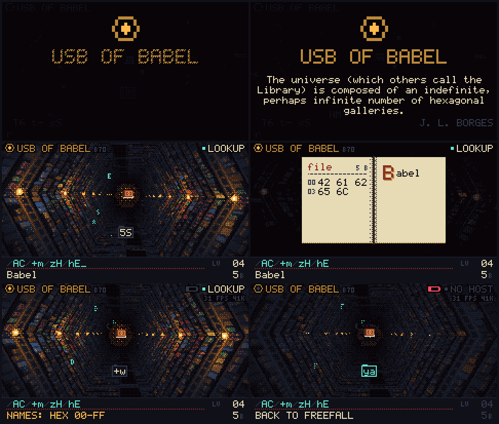

# USB of Babel for the Cardputer ADV

A flash drive that holds every possible file, on the M5Stack Cardputer ADV.

Plug it into a computer and it shows up as a drive whose folders go on forever. Every folder holds one `file`, and its contents are spelled by the path you took to reach it. Somewhere in there is every photo, every song, and this README. You can't search for a file, but you can work out where it lives. Type its contents on the Cardputer's keyboard and the screen shows you the path.

Based on [p2r3/babel-usb](https://github.com/p2r3/babel-usb), from PortalRunner's video [This Flash Drive has Literally Every File](https://www.youtube.com/watch?v=w6rkhvdAqHU).


## The screen: The Air Shaft

> "The universe (which others call the Library) is composed of an indefinite, perhaps infinite number of hexagonal galleries, with vast air shafts between, surrounded by very low railings." (Jorge Luis Borges, *The Library of Babel*)

The display looks straight down one of those air shafts:

- Each floor is a folder. The name tab of the next floor flickers through every possibility, locks the moment your computer opens a folder, then drops into the path bar at the bottom.
- The book at the bottom of the shaft is the `file`. When your computer reads it, the book rises and opens: raw bytes on the left page, text on the right.
- With nothing plugged in, the lamps go out and you fall through the library by lantern light, past random folders.
- The Cardputer's motion sensor tilts the view.



## Install

The firmware is one file: [`firmware/release/babel-usb-cardputer-adv.bin`](firmware/release/babel-usb-cardputer-adv.bin). It is a merged image (bootloader, partition table and app).

**With [Launcher](https://github.com/bmorcelli/Launcher):** copy the `.bin` to the SD card, open it from Launcher's SD menu and install it. To get back to Launcher, restart the Cardputer and interrupt Launcher's start-up as usual.

**Flashing directly** (this replaces Launcher):

```sh
esptool.py --chip esp32s3 write_flash 0x0 babel-usb-cardputer-adv.bin
```

## Use

1. Plug the Cardputer into a computer with a USB-C cable. It appears as an MTP device called **USB of Babel**, with one storage called `disk`.
   - **Windows:** it shows up in File Explorer under This PC.
   - **macOS:** macOS has no built-in MTP support. Use [OpenMTP](https://openmtp.ganeshrvel.com/) or Android File Transfer.
   - **Linux:** GNOME Files and KDE Dolphin open it directly (gvfs-mtp / kio-mtp).
2. Browse into folders. Each one contains 4,900 folders and one `file`.
3. Copy `file` out of any folder to get the file that lives there.

To find where a file lives, type its contents on the Cardputer. The shaft dives to that folder and the path bar shows the path to browse to on your computer. Press enter to open the book and check the contents.

### Keys

| Key | Does |
| --- | --- |
| letters, numbers, symbols | Look up a file by its contents |
| `del` | Back one folder, or delete the last character typed |
| `enter` or the side button (G0) | Open or close the book |
| `tab` (or `fn` + `` ` ``) | Back to the root |
| `fn` + `;` / `fn` + `.` | Brightness up / down |
| `opt` | Switch folder names between Babel-70 and hex (while unplugged) |
| `alt` | Show frame rate and free memory |

Settings are saved on the device.

## How it works

Every folder lists the same objects: 4,900 folders named with two characters from a 70-symbol alphabet (`A–Z a–z 0–9 ! space & ( ) - _ +`), plus `file`. The path is read as a number in bijective base 4,900, and that number is written out as bijective base-256 bytes. That gives every path exactly one file, and every file exactly one path. "Hello" lives at `/AD/HU/Uy/ws`.

In **hex mode** (`opt` while unplugged) each folder instead holds 256 folders named `00` to `FF`, and the path *is* the file, one byte per folder: "Hello" is `/48/65/6C/6C/6F`. Paths are deeper but readable by eye.

The device never stores anything. Folder listings and file contents are worked out on the fly from the path.

Differences from the original babel-usb:

- **Going back works.** The firmware tracks the path by depth, so browsing back up, or copying `file` from a folder your computer had cached, gives the right file.
- **Every file is reachable.** The original's path-to-bytes step gave wrong results for some paths (for example, `/Dt/rn/ni` served the file that belongs at `/vP/ni`, so some files had no path at all). This firmware uses exact arithmetic, checked against `file-to-path.js`'s maths by the tests below.

## Build

You need [PlatformIO](https://platformio.org/). The project uses ESP-IDF 5.5 through the pioarduino platform.

```sh
git clone --recursive https://github.com/BenjaminAddison/babel-USB-Cardputer
cd babel-USB-Cardputer/firmware
pio run
```

The merged image is written to `.pio/build/cardputer-adv/firmware.factory.bin`. If you cloned without `--recursive`, run `git submodule update --init` first: TinyUSB with MTP support is a submodule.

### Tests

The screen code is plain C, so it also builds on a PC. The tests need a C compiler and Node 18 or newer:

```sh
make -C firmware/test test               # file contents vs. the reference maths
cd design && node tools/compare-c.js hex # firmware renderer vs. the JS design, side by side
```

## Repository

| Path | What it is |
| --- | --- |
| `firmware/src/screen/` | The Air Shaft renderer and scene, in portable C |
| `firmware/src/hw/` | Cardputer ADV drivers: ST7789 display, TCA8418 keyboard, BMI270 motion sensor, battery |
| `firmware/src/monolith/` | The MTP device: object handles, listings and the `file` contents |
| `firmware/src/app.c` | Display task: connects USB events, keys and the motion sensor to the screen |
| `firmware/test/` | PC builds of the screen and the file maths, used by the tests |
| `firmware/release/` | The prebuilt firmware image |
| `design/` | The screen's original design: `babel-screen.js` renderer, an interactive concept page (`index.html`) and tools to export GIFs and C tables |
| `docs/TODO.md` | Roadmap and known limitations |

## Credits

- [p2r3 (PortalRunner)](https://github.com/p2r3/babel-usb): the original USB of Babel, its MTP device and the Babel path scheme.
- [TinyUSB](https://github.com/hathach/tinyusb), with MTP support from [RigoLigoRLC/espressif-tinyusb-component](https://github.com/RigoLigoRLC/espressif-tinyusb-component). The MTP handlers started from TinyUSB's MTP example (Ennebi Elettronica).
- [M5Stack](https://github.com/m5stack): pin maps, the ADV keyboard layout and the BMI270 start-up sequence come from M5GFX, M5Unified and M5Cardputer.
- Bosch Sensortec: the BMI270 configuration file.
- Jorge Luis Borges, *The Library of Babel* (1941).

## License

MIT, see [LICENSE](LICENSE). Third-party code keeps its own license, as listed there.
