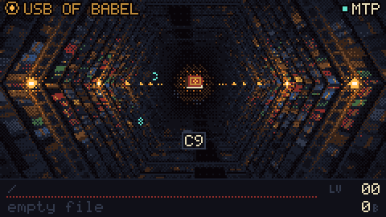

# babel-USB-Cardputer

A USB-of-Babel firmware for the **M5Stack Cardputer ADV**, launched from Launcher. Plugged into a computer, the Cardputer shows up as a drive that contains every possible file: you reach any file by walking a folder path, and the one `file` in each folder contains the path you took.

Based on [p2r3/babel-usb](https://github.com/p2r3/babel-usb), from PortalRunner's [This Flash Drive has Literally Every File](https://www.youtube.com/watch?v=w6rkhvdAqHU).



## Status

The screen concept, **The Air Shaft**, is built as a working renderer. The firmware port hasn't started yet. **[docs/TODO.md](docs/TODO.md)** lists what's done, what's left, and the open decisions.

## What's here

| Path | What it is |
| --- | --- |
| `babel-usb/` | Upstream reference, as a git submodule (ESP-IDF, TinyUSB fork with MTP). Run `git submodule update --init --recursive` after cloning. |
| `design/babel-screen.js` | The screen: a 240×135 renderer and an MTP-driven state machine. Plain JS, no dependencies, writes 16-colour palette indices. Runs in the browser and in Node. |
| `design/index.html` | Interactive concept page: live screen, clickable Cardputer keyboard, host controls, a "find a file" lookup, an MTP log, anatomy, states and the design system. Open it from the `design/` folder so it can load `babel-screen.js`. |
| `design/tools/` | `preview.js` renders PNG contact sheets, `export-gif.js` renders a seamless GIF of one host session, `verify.js` checks the Babel-70 maths against the repo, and `gif.js` / `png.js` are dependency-free encoders. |
| `design/out/` | Rendered GIFs (hex, babel-70, hex @2x) and contact sheets. |
| `docs/TODO.md` | Status and next steps. |

## Commands

Node 18 or newer, run from `design/`:

```sh
node tools/preview.js hex 1.5,4.6,9.0,10.7 3 2   # contact sheet -> out/sheet-hex.png
node tools/export-gif.js hex 1 25                # -> out/babel-screen-hex.gif (scale 2 gives @2x)
node tools/export-gif.js b70 1 25                # same loop with the repo's 70-symbol names
node tools/verify.js                             # cross-check against file-to-path.js and fs_append_output()
```
